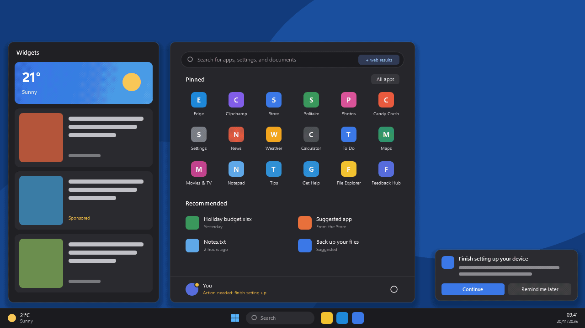
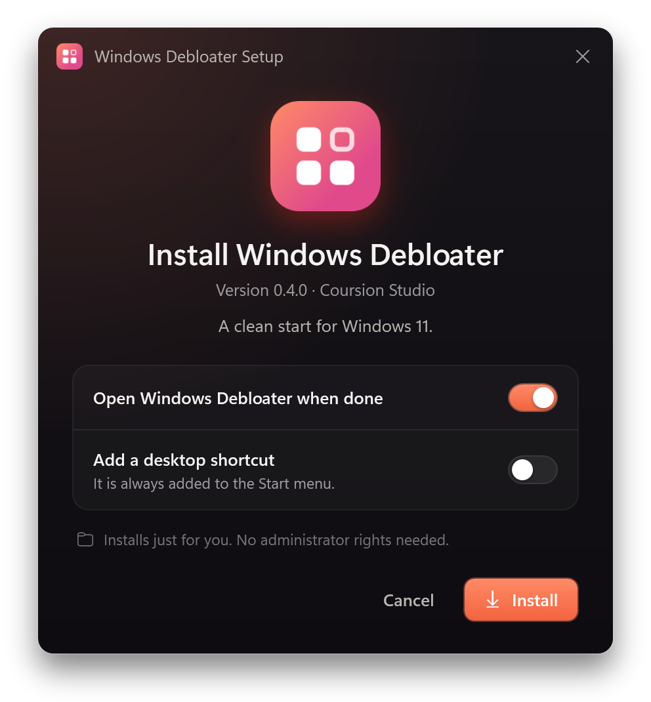
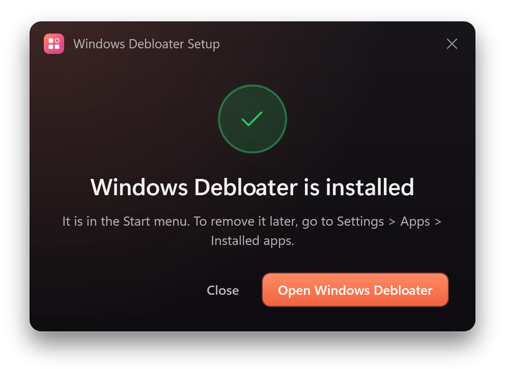
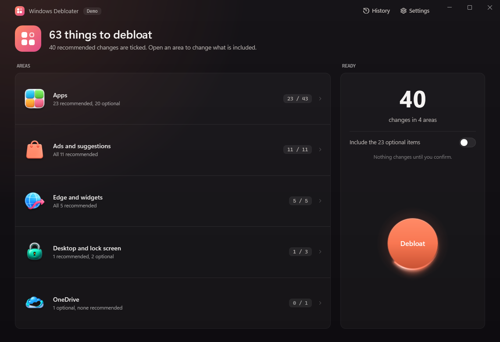
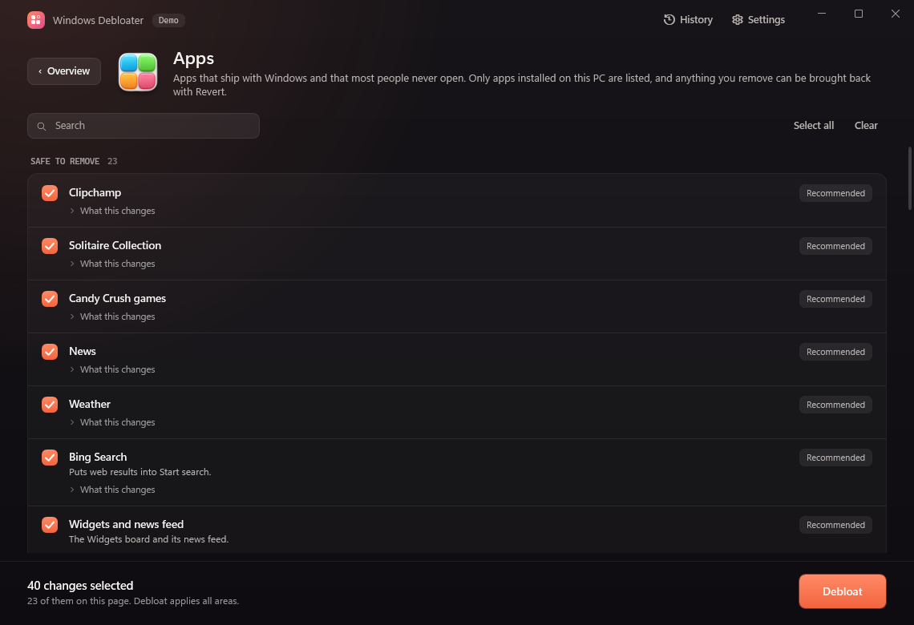
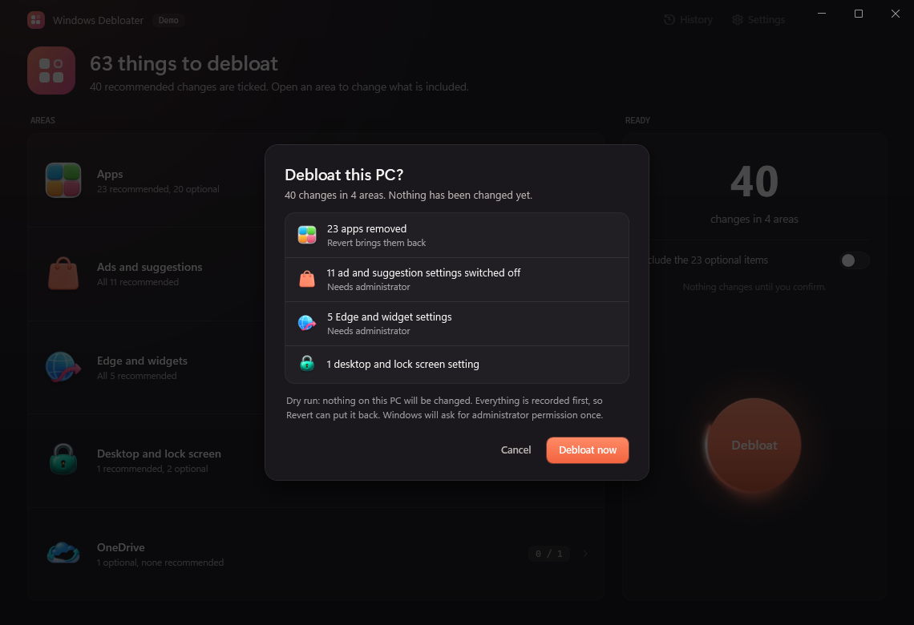
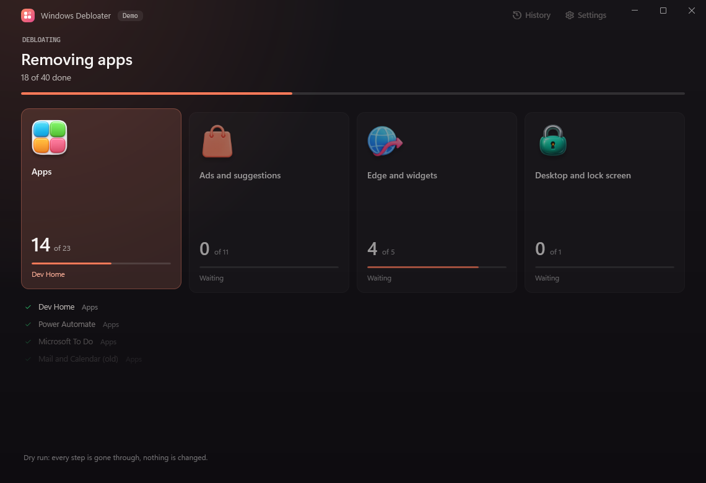
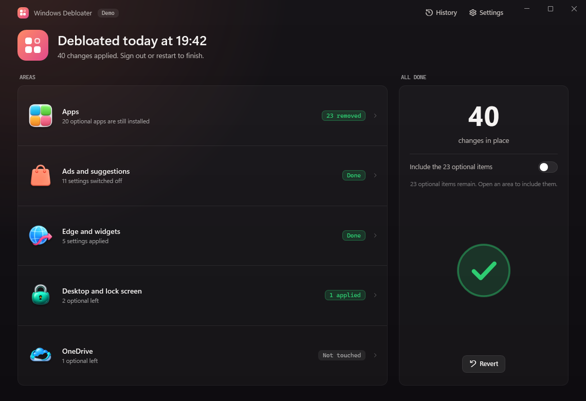
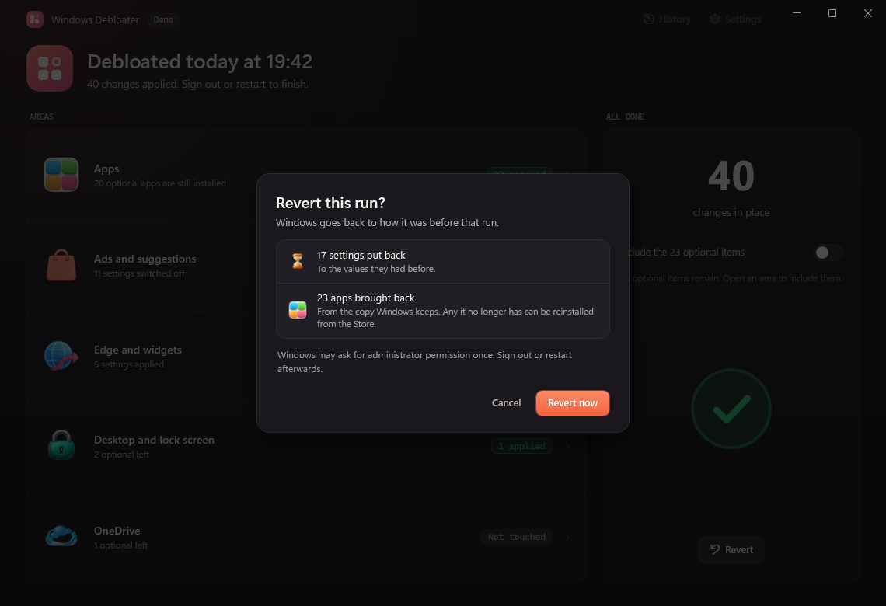
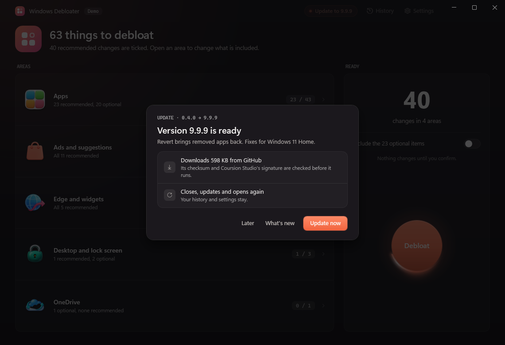

  
   Windows 11 as it comes, one press of Debloat, and what is left. The window is the real one, filmed in demo mode; the desktop around it is a sketch.

  
  
  
  
  

  <b>A clean start for Windows 11.</b> 
  Remove the apps nobody asked for and switch off ads and suggestions, with one button. 
  You confirm before anything changes, and <b>Revert</b> puts it back.

  <a href="https://github.com/Coursion-Studio/windows-debloater/releases/latest"><b>⬇ Download Windows Debloater</b></a>
  &nbsp;·&nbsp; <a href="#-install">Install</a>
  &nbsp;·&nbsp; <a href="#-windows-11-before-and-after">Before and after</a>
  &nbsp;·&nbsp; <a href="#-features">Features</a>
  &nbsp;·&nbsp; <a href="#-screenshots">Screenshots</a>
  &nbsp;·&nbsp; <a href="#-faq">FAQ</a>

---

## 🚀 Install

1. Download **`WindowsDebloaterSetup-x.y.z.exe`** from the [latest release](https://github.com/Coursion-Studio/windows-debloater/releases/latest).
2. Open it and click **Install**. It installs just for you, so **no admin rights** are needed.
3. Windows Debloater opens. Press **Debloat**, read the summary, and press **Debloat now**.

  
  

Setup adds Windows Debloater to the **Start menu** and registers it under **Settings → Apps → Installed apps**.
It **updates itself**: it checks once a day and installs a new version with one click. Every update is signed by Coursion Studio.

> **"Windows protected your PC"?** This SmartScreen warning appears because the installer isn't code-signed yet.
> Click **More info → Run anyway**. Each release includes a `.sha256` file so you can verify the download.

**Without installing:** download `WindowsDebloater-x.y.z.zip` instead, unpack it anywhere and open `WindowsDebloater.exe`. It is the same program.

**Uninstall:** **Settings → Apps → Installed apps → Windows Debloater → Uninstall**. You can choose whether to keep your history. Uninstalling does not undo what the tool changed; use **Revert** for that first.

**Requirements:** Windows 11. Nothing else needs installing.

## 🪟 Windows 11 before and after

What Windows 11 does as it comes, and what is left after one press of **Debloat** with the recommended selection. Which apps a PC ships with depends on its edition, region and maker; the tool only lists what it actually finds.

| | Windows 11 as installed | After Windows Debloater |
|---|---|---|
| Start menu | Promoted apps arrive pinned, and Windows can quietly install more. App suggestions, and reminders about Microsoft 365, OneDrive backup and signing in. | Only what you put there. No promoted installs, no suggestions, no reminders. |
| Start search | Mixes web results from Bing into what you type. | Searches this PC. |
| Preinstalled apps | Clipchamp, Solitaire, Candy Crush, News, Weather, Maps, To Do, Power Automate, Feedback Hub, Get Help and more. | Removed. Revert brings any of them back. |
| Widgets | A Widgets button on the taskbar with a news feed behind it, and weather and news cards on the lock screen. | Blocked, on the taskbar and on the lock screen. |
| Lock screen | Fun facts, tips and promotions over the picture. | Just the picture. |
| Microsoft Edge | Starts with Windows, preloads itself at sign-in and keeps running after you close its window. | Starts when you open it and stops when you close it. Edge stays installed. |
| File Explorer | Promotions for OneDrive and Microsoft 365. | None. |
| Settings app | Suggested content between the settings. | None. |
| Tips and nags | Tips, welcome screens after updates, "finish setting up your device", suggested notifications. | Off. |
| Advertising | An advertising ID that apps can read, and tips and ads tailored from diagnostic data. | Both off. |

That is the recommended selection: 40 changes, ticked when the tool opens. Another 23 are there if you want them and are never applied unless you tick them:

| Optional | What ticking it does |
|---|---|
| Apps that are a matter of taste | Removes Outlook (new), Teams, Copilot, the Microsoft 365 hub, Phone Link, Sticky Notes, Camera, Clock and Sound Recorder, and promoted apps such as Spotify, Netflix, Disney+, Prime Video, TikTok, LinkedIn, Facebook and Instagram. |
| Xbox and gaming | Removes the Xbox app, Xbox Game Bar and the Xbox sign-in helpers, and stops the pop-ups that follow when Game Bar is gone. |
| Lock screen and desktop pictures | Replaces Windows Spotlight and the desktop picture with the standard Windows pictures. |
| OneDrive | Downloads files that exist only online, moves Desktop, Documents and Pictures back to their normal folders and removes OneDrive. |

What it does not claim: it has not been benchmarked, so there are no numbers here about speed, memory or disk space. What changes is what you see, what asks for your attention, and what starts without being asked.

## ✨ Features

|   |   |
|---|---|
| 🧹 **One button** | **Debloat** applies everything that is ticked, in every area, after one confirmation. The recommended changes are ticked when the tool opens. |
| ✅ **You confirm first** | A short summary says what will happen. Nothing changes until you press **Debloat now**. |
| ↩️ **Revert** | Undo a whole run: settings go back to the values they had, the apps it removed come back, and OneDrive is installed again. |
| 🔍 **Nothing hidden** | Every item has a **What this changes** line with the exact app package or registry value. The complete list is in [docs/changes.md](docs/changes.md). |
| 📦 **Only what is there** | It looks at your PC first and lists only the apps and settings it actually finds. |
| 🛡️ **Careful with OneDrive** | Online-only files are downloaded first, your folders are copied back, and nothing is deleted. Work and school accounts are left alone. |
| 🔄 **Automatic updates** | Checks once a day, shows what's new, and installs with one click. Every update is signed by Coursion Studio. |
| 🔒 **Private** | It does its work on your PC. No account, no analytics, no telemetry. The only network call is the daily update check, and Settings can switch it off. |
| 🌍 **English and Turkish** | It starts in your Windows language, with a dark and a light look. |

## 📸 Screenshots

A row opens its area, where you choose exactly what is ticked. Before anything happens, the summary asks you to confirm.

  
  

While it works, each area is a lane that fills up. Afterwards the overview shows what is in place, with **Revert** to undo the run.

  
  

Revert says what comes back before it starts, and a newer version announces itself in the top bar.

  
  

## ⌨️ Shortcuts

| Action | Keys |
|---|---|
| The main action of the screen you are on: Debloat, Debloat now, Done | <kbd>Ctrl</kbd>+<kbd>Enter</kbd> |
| Go back to the recommended selection | <kbd>Ctrl</kbd>+<kbd>R</kbd> |
| Tick everything in the current area | <kbd>Ctrl</kbd>+<kbd>A</kbd> |
| Search the current area | <kbd>Ctrl</kbd>+<kbd>F</kbd> |
| Close the confirmation, clear the search box, or return to the overview | <kbd>Esc</kbd> |

## ❓ FAQ

<b>Can I undo it?</b>

Yes. Press **Revert** on the overview after a run, or open **History** and press **Revert** on any earlier run. Settings always go back to the values they had. Apps come back from the copy Windows itself keeps; if Windows no longer has one, History has a link to that app in the Microsoft Store. OneDrive is installed again, but your folders are not moved back into it: that is yours to choose in OneDrive after signing in.

<b>Why does Windows ask for administrator permission?</b>

Installing never needs it. A run asks once, and only if you ticked a machine-wide setting; those are marked **Needs administrator**. Everything else runs as you.

<b>Settings now says "Some of these settings are managed by your organisation".</b>

A few changes are set the way a company would set them, as a policy, because that is the only switch Windows offers: blocking Widgets, web results in Start search, and the Edge settings. Windows shows that line wherever a policy is in place. **Revert** removes them again.

<b>Does it remove Edge, Defender or the Microsoft Store?</b>

No. Edge stays installed because parts of Windows need it; the tool only stops it starting and running by itself. It does not touch Microsoft Defender, Windows Update or the Store.

<b>Will a Windows update bring things back?</b>

It can. A big Windows update sometimes reinstalls an app or resets a setting. Open Windows Debloater again: it lists only what is there now, so one more press of **Debloat** deals with it.

<b>Can I try it without changing anything?</b>

Yes. Press <kbd>Win</kbd>+<kbd>R</kbd> and run `"%LocalAppData%\Programs\WindowsDebloater\WindowsDebloater.exe" -Demo`. Demo mode pretends everything still needs doing and changes nothing, so you can go through the whole window, Revert included. `-DryRun` does the same against the real state of your PC.

<b>How do I turn off the update check?</b>

**Settings → Check for updates when the tool opens**. With it off, nothing is asked of the internet until you press **Check for updates now** yourself. What the check sends is in [PRIVACY.md](PRIVACY.md).

<b>Where does it keep its files?</b>

The program is in `%LocalAppData%\Programs\WindowsDebloater`. Its history, with the old value of every setting it changed, is in `%LocalAppData%\WindowsDebloater`; that is what Revert reads.

## 🐛 Issues & feedback

Open an issue on this repo, or email [support@coursion.studio](mailto:support@coursion.studio).
The source code lives in a private repo. This one hosts the releases, the update feed and this page.

## 📄 Licence

MIT. See [LICENSE](LICENSE). © 2026 Coursion Studio.
Questions: [support@coursion.studio](mailto:support@coursion.studio) · [coursion.studio](https://coursion.studio)
